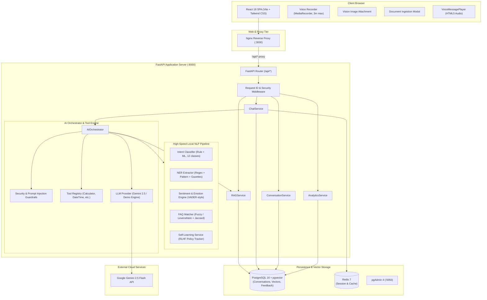
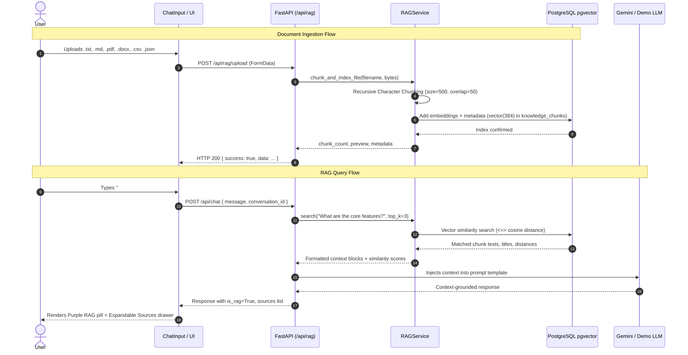
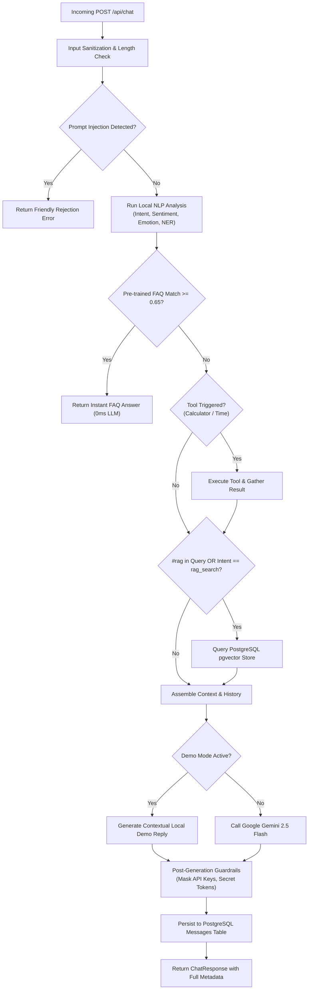
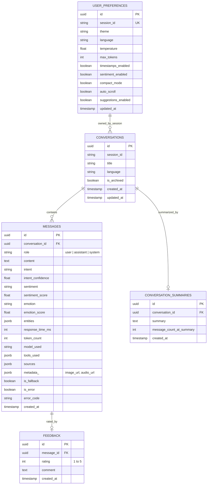

# Dynamic AI Chatbot — Master Architecture Specification

## 1. Executive Summary

The **Dynamic AI Chatbot** is a production-grade, enterprise-ready conversational AI platform built using a modern decoupled monorepo architecture. It blends high-speed deterministic local NLP analysis, semantic Retrieval-Augmented Generation (RAG) using a vector store, multimodal vision and voice interactions, RLHF-driven self-learning, and LLM orchestration (powered by Google Gemini 2.5 Flash with fallback Demo mode).

```
┌──────────────────────────────────────────────────────────────────────────────────┐
│                                DYNAMIC AI CHATBOT                                │
│                                                                                  │
│   ┌─────────────────────┐    REST / SSE    ┌─────────────────────────────────┐   │
│   │   React 18 + Vite   │ ◄──────────────► │        FastAPI Backend          │   │
│   │   Tailwind + Lucide │                  │   (Async Python 3.11 Engine)    │   │
│   └──────────┬──────────┘                  └──────┬──────────┬───────────┬───┘   │
│   ┌──────────▼──────────┐                         ▼          ▼           ▼       │
│   │   Nginx Alpine Web  │                   ┌──────────┐ ┌────────┐ ┌────────┐   │
│   │   Port: 3000        │                   │PostgreSQL│ │pgvector│ │Redis 7 │   │
│   │                     │                   │  16 DB   │ │ Vector │ │ Cache  │   │
│   └─────────────────────┘                   └──────────┘ └────────┘ └────────┘   │
└──────────────────────────────────────────────────────────────────────────────────┘
```

---

## 2. High-Level System Architecture



---

## 3. Core Architectural Subsystems

### 3.1. High-Speed Local NLP Pipeline

Unlike chatbots that make slow, expensive external LLM API calls for every minor text classification task, Dynamic AI includes a dedicated, zero-latency local Python NLP engine:

1. **Intent Classification (`IntentClassifier`)**:
   - Supports 12 distinct functional intent classes: `greeting`, `help`, `weather`, `calculation`, `time_query`, `rag_search`, `document_query`, `faq_query`, `code_generation`, `feedback`, `goodbye`, `general_query`.
   - Uses weighted keyword matching, regex patterns, and scoring heuristics.
   - Calculates primary intent confidence and outputs ranked secondary intents.
2. **Named Entity Recognition (`NERExtractor`)**:
   - Extracts structured entity tokens from free-form text:
     - `DATE` and `TIME` expressions
     - `EMAIL` and `URL` endpoints
     - `TECH` stacks (Python, Docker, React, FastAPI, PostgreSQL, pgvector, etc.)
     - `MONEY` and currency amounts
     - `ORG` organizations (Google, Microsoft, OpenAI, Anthropic, AWS, etc.)
   - Annotates start/end character offsets and confidence ratings.
3. **Sentiment & Emotion Analysis (`SentimentAnalyzer`)**:
   - VADER-style rule-based valence analysis calculating polarity from `-1.0` (extremely negative) to `+1.0` (extremely positive).
   - Classifies emotional state into 7 classes: `happy`, `gratitude`, `frustrated`, `confused`, `curious`, `excited`, `neutral`.
4. **Pre-trained FAQ Engine (`FAQMatcher`)**:
   - Instant response retrieval bypassing LLM latency when exact or high-similarity matches occur (confidence threshold $\ge 0.65$).
   - Combines normalized token Jaccard similarity and character Levenshtein ratio.
   - Covers common system queries, architecture details, deployment tips, and AI concepts.
5. **RLHF Self-Learning Engine (`SelfLearningService`)**:
   - Tracks human feedback rewards $R \in [-1.0, +1.0]$ based on user thumbs up ($+1.0$) and thumbs down ($-1.0$).
   - Calculates policy adaptation weights per intent.
   - Maintains interaction moving averages and provides telemetry to the Analytics dashboard.

---

### 3.2. Retrieval-Augmented Generation (RAG) Architecture

The RAG subsystem enables semantic document retrieval and contextual knowledge grounding:



#### RAG Document Chunking Strategy
- **Recursive Paragraph / Sentence Splitting**: Text is split on double newlines (`\n\n`) to preserve paragraph integrity, falling back to sentence and character boundaries.
- **Sliding Window Overlap**: Configurable overlap (default 50 characters) ensures boundary terms and context across consecutive chunks are never truncated.
- **Header Extraction**: Markdown headers (`#`, `##`, `###`) are extracted and stored as section metadata with every chunk.

---

### 3.3. Multimodal Voice & Vision Architecture

```
┌────────────────────────────────────────────────────────────────────────┐
│                        MULTIMODAL ARCHITECTURE                         │
├──────────────────────────────────┬─────────────────────────────────────┤
│        🎙️ Voice Pipeline         │          📷 Vision Pipeline         │
├──────────────────────────────────┼─────────────────────────────────────┤
│ • MediaRecorder Web API          │ • File input (.png, .jpg, .webp)    │
│ • Hard cap: 180s (3 minutes)     │ • FileReader to Base64 Data URL     │
│ • Auto-stop on 3:00 reached      │ • Thumbnail preview in input dock   │
│ • Base64 Data URL serialization  │ • Ingested via ChatRequest payload  │
│ • Stored in message metadata_    │ • Forwarded to Gemini Vision parts  │
│ • Playback via VoiceMessagePlayer│ • Fallback demo image recognizer    │
│ • TTS Read-Aloud (SpeechSynthesis│ • Rendered in MessageBubble user tag│
└──────────────────────────────────┴─────────────────────────────────────┘
```

1. **Voice Message Flow**:
   - Capped at a strict **3-minute (180s) maximum** timer with auto-send upon expiration.
   - User controls: Pause, Resume, Discard (Trash), and Send Voice.
   - Sends audio directly as a Base64 WebM audio payload without cluttering the text input.
   - User message bubble renders an interactive `VoiceMessagePlayer` with play/pause, scrubbable progress bar, and elapsed time counters.
   - Text-to-speech (TTS) read-aloud enabled on assistant responses using the browser SpeechSynthesis API.
2. **Vision Message Flow**:
   - User attaches an image via file picker or drag-and-drop.
   - Preview card with instant removal button in the input tray.
   - Handled directly by Gemini Vision API or local multimodal demo fallback.
   - Rendered natively in the message thread.

---

### 3.4. Orchestration & Guardrails Flow

Every incoming chat request passes through a multi-stage deterministic pipeline:



---

## 4. Database & Persistence Layer

The database uses **PostgreSQL 16** managed via **SQLAlchemy 2.0 (AsyncIO)** and **Alembic**:



### Critical Database Invariants:
1. **Async Relationship Loading**: Repositories use `selectinload(Message.feedback)` to avoid SQLAlchemy `MissingGreenlet` exceptions in async event loops.
2. **Metadata Ingestion**: User attachments (Base64 audio and vision images) are stored directly inside `messages.metadata_` as JSONB, ensuring history reload preserves all attachments.

---

## 5. Deployment Topology & Docker Configuration

The production setup uses a 5-container microservice topology:

| Container Name | Service | Base Image | Port Mapping | Healthcheck |
|----------------|---------|------------|--------------|-------------|
| `chatbot-frontend` | React SPA | `nginx:alpine` | `3000:80` | `GET /` |
| `chatbot-backend` | FastAPI App | `python:3.11-slim` | `8000:8000` | `GET /api/health` |
| `chatbot-postgres` | Vector + Relational DB | `pgvector/pgvector:pg16` | `5432:5432` | `pg_isready -U chatbot` |
| `chatbot-redis` | Cache Store | `redis:7-alpine` | `6379:6379` | `redis-cli ping` |
| `chatbot-pgadmin` | DB GUI Manager | `dpage/pgadmin4:latest` | `5050:80` | Native |

### Network & Security Architecture
- Internal Docker bridge network (`chatbot-network`) isolates backend services.
- Nginx acts as reverse proxy forwarding `/api/*` to `http://chatbot-backend:8000/api/*`.
- Environment variables configured strictly via `.env`.

---

## 6. Complete API Endpoint Reference

| Method | Endpoint | Description |
|--------|----------|-------------|
| `POST` | `/api/chat` | Main conversational endpoint (supports text, image, audio) |
| `POST` | `/api/chat/stream` | Server-Sent Events (SSE) streaming chat |
| `GET` | `/api/conversations` | List user conversations with categorized badges |
| `GET` | `/api/conversations/{id}` | Get full conversation history with all message metadata |
| `DELETE` | `/api/conversations/{id}` | Delete a conversation and all attached messages |
| `POST` | `/api/conversations/{id}/export` | Export conversation in JSON, TXT, or Markdown |
| `POST` | `/api/rag/upload` | Upload & index document (.txt, .md, .pdf, .docx, .csv, .json) |
| `GET` | `/api/rag/documents` | List indexed PostgreSQL pgvector documents and chunk counts |
| `DELETE` | `/api/rag/documents/{title}` | Remove document and all chunks from vector index |
| `POST` | `/api/rag/search` | Direct semantic search over knowledge base |
| `GET` | `/api/analytics/overview` | KPI overview (total conversations, messages, avg response time) |
| `GET` | `/api/analytics/sentiment` | Sentiment distribution (positive, neutral, negative) |
| `GET` | `/api/analytics/intents` | Intent frequency distribution |
| `GET` | `/api/analytics/activity` | 30-day time-series activity data |
| `GET` | `/api/settings` | Retrieve user preferences for current session |
| `PUT` | `/api/settings` | Update user preferences |
| `POST` | `/api/feedback` | Submit thumbs up/down rating and update RLHF model |
| `GET` | `/api/learning-stats` | Retrieve RLHF adaptation stats and policy reward weights |
| `GET` | `/api/health` | Service health status, database ping, and demo mode indicator |

---

## 7. Verification & Testing

- **Backend Unit & Integration Tests**: 31 comprehensive pytest suites verifying:
  - Security & prompt injection guardrails
  - Tool execution & registry
  - Demo provider & LLM provider abstraction
  - Intent classification, NER, sentiment, emotion analysis
  - FAQ fuzzy matching
  - PostgreSQL pgvector RAG chunking and indexing
  - Self-learning RLHF reward updates
- **Frontend Verification**: TypeScript type validation (`tsc -b`), production Vite bundling, and cross-browser testing across mobile and desktop viewport profiles.
